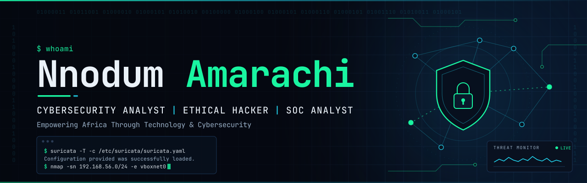

  

  

## 👋 Hi, I'm Amarachi Nnodum

I'm a **cybersecurity analyst and ethical hacker in training** with a background in education. I'm passionate about **cybersecurity, ethical hacking, SOC and defensive monitoring, Linux, DevSecOps, and technology education**.

I document every lab with evidence, so you can see how I work and not only what I know.

## 📌 About Me

- 🔐 Building my career in cybersecurity through the **TechQuest** programme, after completing **TechRise 3.0** (cybersecurity and DevSecOps)
- 🧪 Developing practical skills in ethical hacking, network monitoring, and security analysis
- 🖥️ Enjoy hands-on labs on Kali Linux: IDS configuration, packet analysis, and attack surface mapping
- 📚 Come from a teaching background: Mathematics and Physics tutor and Montessori-trained educator
- 🗣️ Believe in explaining technical findings clearly, to technical and non-technical readers alike
- 🌍 Based in Nigeria

## 🛡️ Cybersecurity

- **Network security and monitoring**: packet analysis, IDS/IPS rule writing, and alert testing
- **Vulnerability assessment**: host discovery, port and service scanning, risk scoring, and remediation planning
- **Web application security**: OWASP Top 10 concepts, SQL injection and XSS in lab environments
- **Reconnaissance and threat analysis**: passive and active recon, MITRE ATT&CK mapping, and CVE briefings
- **Linux security**: users, permissions, ownership, and listening-service review
- **DevSecOps**: CI security scanning, secrets detection, and container and infrastructure-as-code scanning
- **Digital forensics fundamentals**: disk and memory forensics labs
- **Security documentation**: evidence-based reports and risk registers

## 🧰 Tools & Technologies

  
  
  
  
  
  
  

  
  
  
  
  
  

  

## 🌱 Currently Learning

| Stage | Focus |
|---|---|
| ✅ Foundations practised | Linux administration and permissions, networking and packet analysis, Kali Linux, Git and GitHub |
| 🔄 In progress | SOC monitoring and log analysis (Suricata, syslog, CEF, JSON logs) · Security standards and compliance (NIST CSF, CIS Controls, ISO 27001, CISSP domains) · Penetration testing planning and scoping · Web application security |
| ⏭ Next | Python for security automation · Cloud and container security · Industry certification pathways |

## 🧪 Hands-On Cybersecurity

I learn by doing, in controlled labs I own, using Kali Linux as my workstation and deliberately vulnerable or training machines such as **Metasploitable 2** and a **Cybersecurity LabVM**, on isolated VirtualBox host-only networks.

- Network reconnaissance and host discovery with Nmap
- Service identification and attack surface mapping
- Packet capture and traffic analysis with Wireshark and tcpdump
- IDS configuration and custom rule writing with Suricata
- Vulnerability analysis and risk scoring
- Web application security testing and exploitation in authorized lab environments (coursework)
- Security reporting, with observed facts kept separate from hypotheses

> All of this is done for **ethical, educational, and authorized** purposes only, inside approved lab scope.

## 🚀 Featured Projects

| Project | What it covers |
|---|---|
| [🗺️ Attack Surface Mapping Lab](https://github.com/Amarachi-Nnodum/attack-surface-mapping-lab) | Authorized assessment of a simulated organisation in an isolated lab: Nmap discovery, service inventory, risk scoring, Wireshark capture, and a remediation plan |
| [🛡️ Suricata IDS Activity](https://github.com/Amarachi-Nnodum/Suricata-Activity) | Suricata IDS lab: eve.json vs fast.log logging, configuration backup, custom detection rules, and alert testing |
| [🐧 Linux Practice](https://github.com/Amarachi-Nnodum/LINUX_PRACTICE) | Linux command-line and user-management tasks on Kali: users, permissions, ownership, and file operations, documented with evidence |
| [⚙️ DevSecOps Security Pipeline](https://github.com/Amarachi-Nnodum/week10-devsecops-security) | A vulnerable Flask API, a remediated version, and a GitHub Actions workflow running Bandit, pip-audit, and Gitleaks |
| [🔍 PayliteNG Pentest Portfolio](https://github.com/Amarachi-Nnodum/payliteng-pentest-portfolio) | Penetration testing skills portfolio: recon, threat modeling, log analysis, and exploitation |

## 📊 GitHub Stats

  
  

  

## 🧭 My Philosophy

**Learn → Build → Secure → Share → Empower**

I believe practical cybersecurity knowledge and good technology education can help people build meaningful careers and contribute to a safer digital environment. That's why I document what I learn and share it openly.

## 🤝 Let's Connect

  
  
  

  <em>Empowering Africa through technology and cybersecurity.</em> 
  Thanks for visiting. 🛡️

